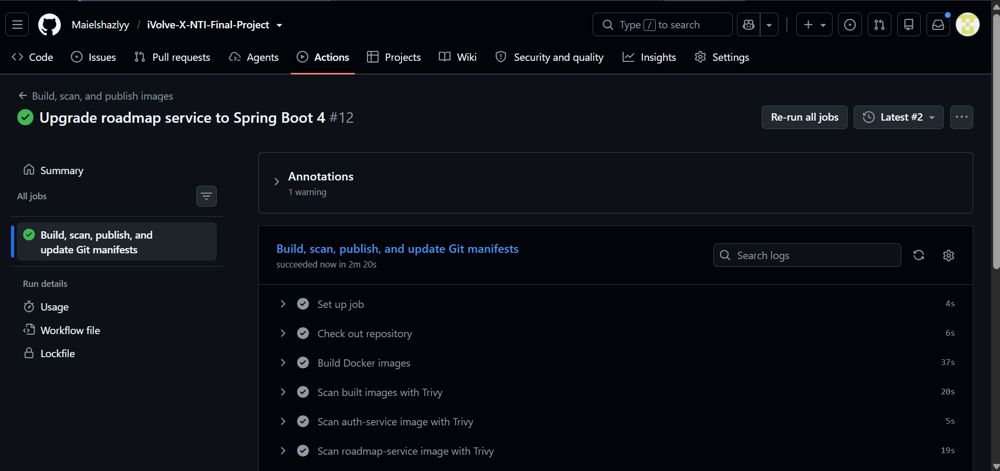

# IVOLVE × NTI Cloud DevOps Accelerator

This project takes the iVolve DevOps training application from local source code to a running, cloud-hosted service. It demonstrates the full delivery path: containerize the application, provision AWS infrastructure with Terraform, build and scan images with GitHub Actions, and continuously deploy Kubernetes manifests with Argo CD.

The application includes a frontend, an authentication API, a roadmap API, and MySQL. The local Docker Compose stack helps develop the services together. In AWS, the services run on Amazon EKS, images are stored in Amazon ECR, MySQL uses persistent EBS storage, and an AWS Application Load Balancer exposes the frontend.

## Project walkthrough

https://github.com/user-attachments/assets/15d4caff-41cf-45da-ae90-4e9e882caf9e

## Project requirements and implementation

| Area | Project outcome |
|---|---|
| GitHub and source | Source, infrastructure, deployment manifests, workflows, and documentation are version-controlled in this repository. |
| Docker | `docker/compose.yaml` runs the frontend, APIs, and MySQL locally. |
| Terraform | Reusable modules provision the VPC, public/private subnets, gateways, network ACLs, EKS with two workers, ECR repositories, IAM permissions, and an encrypted S3 state backend. Jenkins EC2 has been removed from the design. |
| Kubernetes | Manifests define the `ivolve` namespace, Deployments and Services, MySQL StatefulSet and headless Service, gp3 StorageClass, ConfigMap, Secret contract, and frontend Ingress. |
| CI | GitHub Actions builds each service image, scans images with Trivy, pushes immutable commit-tagged images to ECR, then commits the updated image references to Kubernetes manifests. |
| CD | Argo CD watches the Git repository and automatically syncs `kubernetes/overlays/dev` to EKS. The workflow does not call `kubectl` or deploy directly. |
| Documentation | Each major folder has one README explaining that component's files, setup, commands, and verification. Start with the linked folder guides below. |

## Delivery architecture


```text
Application change
  → GitHub Actions builds and scans Docker images
  → immutable image tags are pushed to Amazon ECR
  → GitHub Actions commits those tags to Kubernetes manifests
  → Argo CD sees the Git change and syncs the dev overlay to Amazon EKS
  → AWS Load Balancer Controller routes browser traffic to the frontend
```

Terraform provisions the AWS foundation and stores dev state remotely in S3. The AWS Load Balancer Controller handles the public ALB; Argo CD manages the application resources declared in Git.

## Project sections

Each section below summarizes what this project implements. Follow its guide for the file map, prerequisites, exact commands, troubleshooting, and verification steps. The section guides are the detailed instructions; this README is the project overview.

### 1. Application source

The application is split into a browser-facing frontend, an authentication API, a roadmap API, and a MySQL database. The frontend handles sign-in and the training dashboard; the APIs provide application functions and use MySQL for persistent data. Keeping each service in its own folder lets the local Compose stack and cloud deployment build and release them independently.

Continue with the [application guide](app/README.md) for the service layout, technology choices, configuration, and local development notes.

### 2. Local containerization with Docker Compose

Docker Compose builds and runs the frontend, both APIs, and MySQL together on a developer machine. The services communicate over the Compose network; configuration is supplied through a local environment file, and health checks help indicate when the dependencies are ready. This gives the project a repeatable local workflow before publishing images to AWS.

Continue with the [Docker guide](docker/README.md) for environment setup, build and run commands, health checks, logs, and cleanup.

### 3. AWS infrastructure with Terraform

Terraform provisions the cloud foundation in reusable modules: a VPC with public and private subnets, internet/NAT routing and network ACLs; an EKS cluster with two worker nodes in separate Availability Zones; ECR repositories for the service images; and the IAM permissions used by the platform. Terraform state for the dev environment is stored remotely in an S3 backend. The current design removes the Jenkins EC2 host and its Jenkins-specific provisioning.

Continue with the [Terraform guide](terraform/README.md) for bootstrapping the S3 backend, AWS authentication, module details, plan/apply commands, verification, and safe teardown.

### 4. Kubernetes application platform

The Kubernetes manifests define the `ivolve` namespace, Deployments and Services for the frontend and APIs, and a MySQL StatefulSet with a headless Service and persistent gp3 storage. A ConfigMap holds non-sensitive settings; the application Secret is created separately so credentials are not committed to Git. An Ingress and the AWS Load Balancer Controller expose the frontend through an AWS Application Load Balancer. The dev overlay collects the manifests that Argo CD reconciles.

Continue with the [Kubernetes guide](kubernetes/README.md) for manifest structure, secret creation, rollout behavior, Argo CD handoff, and cluster verification.

### 5. Continuous integration with GitHub Actions

GitHub Actions provides CI for the microservices. The workflow builds Docker images, scans them with Trivy, and on the publishing branch pushes commit-tagged images to the project’s ECR repositories. It then updates the image references in the Kubernetes manifests in Git. The workflow does not deploy directly to the EKS API; Argo CD handles that step.

Continue with the [GitHub Actions guide](.github/README.md) for workflow triggers, repository secrets, ECR permissions, scan behavior, and manifest updates.

### 6. Continuous delivery with Argo CD

Argo CD watches the repository’s `main` branch and the `kubernetes/overlays/dev` path. When CI commits a new image reference, Argo CD detects the Git change and reconciles the declared application resources into EKS. Its Application view reports synchronization and health, making the Git revision and deployment state visible in one place.

Continue with the [Argo CD guide](argocd/README.md) for installation, Application registration, access, synchronization, and troubleshooting. The Kubernetes resource details remain in the [Kubernetes guide](kubernetes/README.md).

### 7. Architecture, screenshots, and demo

The documentation includes the branded architecture diagram, evidence screenshots for local Compose, successful CI, Argo CD health, EKS workloads, and the live application, plus project walkthrough videos. The evidence shows the current GitHub Actions CI → Git manifests → Argo CD CD flow.

Continue with the [documentation guide](docs/README.md) to view the evidence and videos, and to find instructions for regenerating the visual assets.

## Verification evidence

Screenshots and the project walkthrough video are collected in [`docs/README.md`](docs/README.md). The repository includes evidence of the local Compose stack, the application through the ALB, healthy EKS nodes and workloads, successful CI runs, and successful Argo CD synchronization when available.

### Local Docker Compose


### GitHub Actions CI



### Argo CD continuous delivery


### EKS workloads and persistent storage


### Application through the AWS ALB


## Operational and security notes

- Never commit `.env` files, `kubernetes/app-secrets.local`, AWS access keys, GitHub tokens, SSH keys, Terraform state, or secret backend configuration.
- The CI IAM user should only publish images to the project's ECR repositories. Argo CD receives read access to the Git repository and uses its in-cluster identity to manage application resources.
- Review every Terraform plan before applying. Removing the Jenkins module will plan deletion of the Jenkins EC2 instance and related IAM/security-group resources; the apply is intentionally left for the operator to review and approve.
- EKS, worker EC2, NAT Gateway, ALB, public IPv4, EBS, ECR storage, and data transfer can incur charges. For safe shutdown and data retention, use the teardown and backup instructions in [`terraform/README.md`](terraform/README.md).
