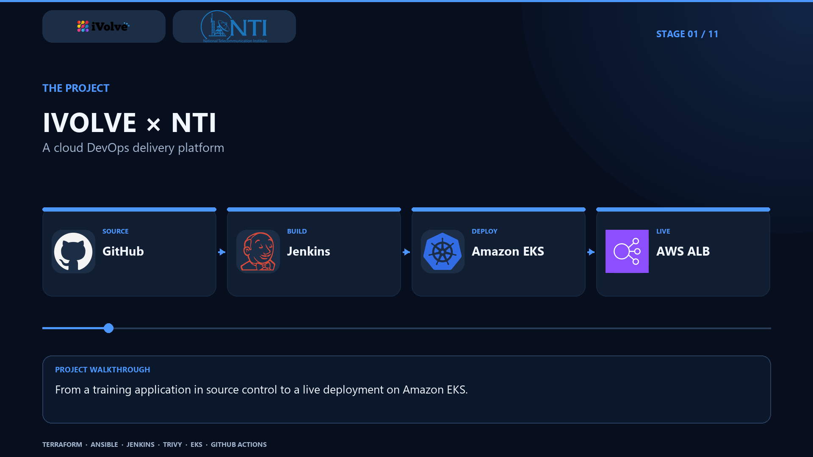
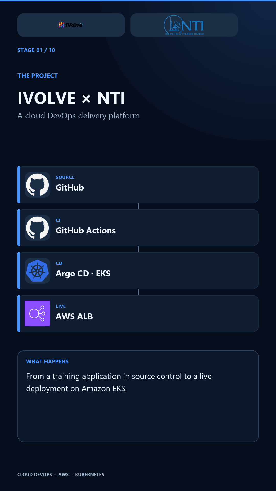

# IVOLVE × NTI Cloud DevOps Platform

An end-to-end DevOps project that takes the IVOLVE training-roadmap application from local development to AWS. The repository contains the application, Docker Compose environment, Terraform infrastructure, Ansible host configuration, Jenkins CI pipelines, Kubernetes manifests, and GitHub Actions deployment workflow.

> **Start here:** this file explains the project, its architecture, and the end-to-end run order. Each major component has one README at its top level (`app/README.md`, `ansible/README.md`, `jenkins/README.md`, and so on); each one covers the files and commands for its component. Subfolders do not have separate README files.

## Project at a glance

The application has three services and a database:

| Component | Technology | Responsibility |
|---|---|---|
| Frontend | Node.js, Express, EJS | Login/signup pages and roadmap UI |
| Auth API | Python, Flask, MySQL connector | Registers users and validates passwords |
| Roadmap API | Java 21, Spring Boot | Returns roadmap topics as JSON |
| Database | MySQL 8 | Persists user accounts for the Auth API |

The project demonstrates these outcomes:

1. Run the complete application locally with Docker Compose.
2. Provision the AWS network, Jenkins host, EKS cluster, ECR repositories, and Terraform state backend with Terraform.
3. Configure the Jenkins EC2 host with Ansible.
4. Build and scan each service image with Jenkins and Trivy, publish it to ECR, and update its Kubernetes manifest in Git.
5. Deploy manifest changes to EKS with GitHub Actions and verify the application through an AWS Application Load Balancer.

## Full architecture


The architecture diagram is also available as an editable vector at [`docs/images/ivolve-platform-architecture.svg`](docs/images/ivolve-platform-architecture.svg). The PNG is ready for presentation slides and LinkedIn posts.

### Delivery flow

```text
Developer change
  → GitHub source repository
  → Jenkins pipeline for the changed service
  → Docker build and Trivy scan on the connected build agent
  → Amazon ECR image tagged with the Jenkins build number
  → Jenkins updates that service's Kubernetes manifest and pushes the commit
  → GitHub Actions runs on the self-hosted runner on Jenkins EC2
  → Kustomize applies the development manifests to Amazon EKS
  → Kubernetes rolls out the new service image
  → Browser reaches the frontend through the AWS ALB Ingress
```

Terraform provisions AWS resources. Ansible configures the Jenkins EC2 host. These are setup/configuration stages; they are not run for every application image deployment.

### Important deployment requirement note

The assignment brief itself is not stored in this repository, so the checklist below reflects the project requirements recorded here. The current deployment workflow is GitHub Actions. The earlier project notes say Argo CD was named in the brief, but the deployed implementation uses event-driven GitHub Actions instead. GitHub Actions is **not** Argo CD and does not continuously reconcile cluster drift. If the grading rubric requires Argo CD specifically, treat that as an open requirement and confirm the accepted alternative with the instructor; do not describe the two tools as equivalent.

## Requirement and delivery status

| Project area | Status | Evidence/verification |
|---|---|---|
| Application and Docker Compose | Complete | Local Compose stack and browser view documented in [`docker/README.md`](docker/README.md). |
| Terraform network, Jenkins EC2, EKS, ECR, S3 backend | Deployed | S3 state migration completed; public/private ACLs applied; latest `terraform plan` returned no changes. See [`terraform/README.md`](terraform/README.md). |
| Ansible Jenkins configuration | Complete | Playbook recap reported `failed=0`, `unreachable=0`, and a later idempotency run with `changed=0`. See [`ansible/README.md`](ansible/README.md). |
| Kubernetes application, MySQL storage, and ALB | Deployed | EKS nodes Ready, all four application/database pods Running, and frontend Ingress has an ALB address. See [`kubernetes/README.md`](kubernetes/README.md). |
| Jenkins pipeline for all three services | Complete | User confirmed auth-service, roadmap-service, and frontend pipelines passed, including image build/scan/push and manifest update. See [`jenkins/README.md`](jenkins/README.md). |
| GitHub Actions deployment | Complete | User confirmed the workflow succeeded after service manifest updates; it applies the dev overlay and waits for rollouts. See [`.github/README.md`](.github/README.md). |
| Project demo video | Ready | Logo-led landscape and vertical explainers, with and without explanation panels, are available in [`docs/README.md`](docs/README.md). |

## Repository and README guide

There is one detailed README for each major component folder. Each guide brings together the relevant subfolder structure, setup steps, commands, and expected output.

| Folder | What it contains | Folder guide |
|---|---|---|
| `app/` | Frontend, Auth API, Roadmap API | [`app/README.md`](app/README.md) |
| `docker/` | Local Compose stack, env template, service health checks | [`docker/README.md`](docker/README.md) |
| `terraform/` | AWS infrastructure and Terraform state management | [`terraform/README.md`](terraform/README.md) |
| `ansible/` | Dynamic AWS inventory and Jenkins configuration | [`ansible/README.md`](ansible/README.md) |
| `jenkins/` | Controller/agent setup, pipeline definitions, shared library | [`jenkins/README.md`](jenkins/README.md) |
| `kubernetes/` | Shared manifests, dev overlay, storage, and Ingress | [`kubernetes/README.md`](kubernetes/README.md) |
| `.github/` | GitHub repository automation | [`.github/README.md`](.github/README.md) |
| `docs/` | Architecture diagram, demo videos, covers, and generation assets | [`docs/README.md`](docs/README.md) |

## Quick start: local application

### Requirements

- Docker Desktop running with the Linux container engine.
- Git.
- PowerShell 7 or Windows PowerShell.

Run these commands from the repository root:

```powershell
Copy-Item docker/.env.example docker/.env
notepad docker/.env
```

Set unique local-only values for `MYSQL_ROOT_PASSWORD`, `DB_USER`, `DB_PASSWORD`, and `SESSION_SECRET` in `docker/.env`. Keep this ignored file private.

Build the Spring Boot JAR in the Maven builder container, then build and start the application:

```powershell
docker compose --profile build --env-file docker/.env -f docker/compose.yaml run --rm roadmap-builder
docker compose --env-file docker/.env -f docker/compose.yaml up --build --detach
docker compose --env-file docker/.env -f docker/compose.yaml ps
```

Open [http://localhost:3000](http://localhost:3000), create an account, sign in, and view the roadmap. To stop the stack while preserving MySQL data:

```powershell
docker compose --env-file docker/.env -f docker/compose.yaml down
```

For logs, health checks, and troubleshooting see [`docker/README.md`](docker/README.md). The first Maven build can take several minutes. Do not use `down --volumes` unless you intentionally want to delete local database data.

## AWS infrastructure and Terraform

### What Terraform manages

- VPC, public/private subnets in two Availability Zones, Internet Gateway, NAT Gateway, route tables, and public/private Network ACLs.
- Jenkins controller EC2 instance, instance profile, ECR publishing permissions, and restricted admin access.
- EKS control plane and private managed worker nodes.
- ECR repositories for `frontend`, `auth-service`, and `roadmap-service`.
- EKS Pod Identity resources for the EBS CSI and AWS Load Balancer controllers.
- A versioned, encrypted, private S3 bucket used for the dev Terraform state. The bucket-bootstrap root retains its own local state.

The deployed region is `eu-north-1`. Environment outputs, backend setup, module descriptions, and operating commands are in [`terraform/README.md`](terraform/README.md).

### Working with the existing deployment

From PowerShell:

```powershell
Set-Location "C:\Users\Shazly\Documents\Codex\IVOLVE-X-NTI-Final-Project\terraform\environments\dev"
terraform init -backend-config=backend.hcl
terraform state list
terraform validate
terraform plan
```

The `backend.hcl` is intentionally ignored by Git; create it from `backend.hcl.example` on a fresh authorized workstation and set it to the project's S3 state bucket. AWS credentials must be active before Terraform can refresh remote resources. Keep the local pre-migration state file as a recovery copy until the S3 state is independently confirmed.

For a new environment, follow the bootstrap and dev-environment sections in [`terraform/README.md`](terraform/README.md). Refresh administrator and Ansible-host IP allow-lists before planning. Always inspect the complete plan before applying live network changes.

## Ansible: configure Jenkins EC2

Run Ansible from the Ubuntu control host. The AWS EC2 inventory discovers the Jenkins controller by its project/environment/name tags. Store the SSH private key outside Git and load it into the current shell:

```bash
cd ~/iVolve-X-NTI-Final-Project/ansible
export ANSIBLE_PRIVATE_KEY_FILE="$HOME/.ssh/lab28-ansible.pem"
chmod 600 "$ANSIBLE_PRIVATE_KEY_FILE"
ansible-inventory --graph
ansible jenkins -m ping
ansible-playbook playbooks/configure-jenkins.yml --syntax-check
ansible-playbook playbooks/configure-jenkins.yml --ask-become-pass
```

Expected checks: inventory contains the Jenkins EC2 host; ping returns `"ping": "pong"`; syntax check prints the playbook name; successful recap shows `failed=0`. See [`ansible/README.md`](ansible/README.md) for control-host packages and dynamic inventory details.

## Jenkins CI

Jenkins controller: Terraform-managed EC2. Jenkins image builder: `ivolve-build-agent`, a Docker container connected over WebSocket. GitHub Actions runner: a separate self-hosted runner service on the Jenkins EC2 host. The two agents have different roles; the GitHub runner deploys to EKS, while the Docker build agent builds/scans images.

Create three **Pipeline script from SCM** jobs on Jenkins, each pointing to `main` and the indicated Jenkinsfile:

| Jenkins job | Script path | Service image/repository |
|---|---|---|
| `ivolve-frontend` | `jenkins/pipelines/frontend.Jenkinsfile` | `frontend` |
| `ivolve-auth-service` | `jenkins/pipelines/auth-service.Jenkinsfile` | `auth-service` |
| `ivolve-roadmap-service` | `jenkins/pipelines/roadmap-service.Jenkinsfile` | `roadmap-service` |

Configure the trusted global Shared Library `ivolve-shared` from this repository, default branch `main`, library path `jenkins/shared-library`. Set up Jenkins credentials `aws-ecr-push` and `github-manifest-push` as described in [`jenkins/README.md`](jenkins/README.md). Never place secret values in pipeline files or screenshots.

For a local Docker build agent, copy `jenkins/.env.example` to the ignored `jenkins/.env`, fill in the controller URL and agent secret locally, then run:

```powershell
docker compose --env-file jenkins/.env -f jenkins/agent.compose.yaml up -d --build
docker ps --filter name=ivolve-build-agent
docker logs --tail 30 ivolve-build-agent
```

Expected agent log includes `WebSocket connection open` and `Connected`. Exact Jenkins job setup, credentials, and verification are in [`jenkins/README.md`](jenkins/README.md).

## GitHub Actions deployment

The deploy workflow is `.github/workflows/deploy-dev.yml`. It runs on `workflow_dispatch` or when one of the service manifests changes on `main`. The runner labels are `self-hosted`, `linux`, and `x64`. Configure repository Actions secrets for AWS deployment and app/database configuration; exact secret names and workflow behavior are in [`.github/README.md`](.github/README.md).

The AWS Organization Service Control Policy blocks creation of the GitHub OIDC provider in this account. The current implementation therefore uses a dedicated IAM deploy user's access keys in repository secrets. Treat these as credentials, rotate/revoke them when appropriate, and never include their values in public evidence.

## Kubernetes and application verification

Configure kubectl for the deployed cluster. In PowerShell, if `aws` is not on `PATH`, call the AWS CLI executable by full path:

```powershell
$awsExe = "$env:LOCALAPPDATA\Programs\Amazon\AWSCLIV2\aws.exe"
& $awsExe eks update-kubeconfig --name ivolve-x-dev --region eu-north-1
kubectl config current-context
kubectl get nodes
kubectl get pods -n ivolve
kubectl get deployments,statefulsets,services,pvc -n ivolve
kubectl get ingress -n ivolve
```

Expected deployment health: EKS nodes report `Ready`, four `ivolve` pods report `Running`/ready, the MySQL PVC is `Bound`, and the frontend Ingress has an ALB `ADDRESS`. Open that current address with `http://` and test signup/login and the roadmap. The ALB DNS hostname can change; get it from `kubectl get ingress -n ivolve` rather than copying an old URL.

After a deployment, verify the rollout:

```powershell
kubectl rollout status deployment/auth-service -n ivolve --timeout=300s
kubectl rollout status deployment/roadmap-service -n ivolve --timeout=300s
kubectl rollout status deployment/frontend -n ivolve --timeout=300s
```

## Evidence and demo

The architecture image is source-controlled, and the stage-by-stage explainer videos are ready:

- [Watch or download the GitHub/portfolio explainer](docs/demo/ivolve-devops-explainer.mp4) (16:9, 67 seconds).
- [Watch or download the LinkedIn explainer](docs/demo/ivolve-devops-linkedin.mp4) (9:16, 55 seconds).
- [Watch or download the clean GitHub/portfolio version without explanation panels](docs/demo/ivolve-devops-explainer-no-captions.mp4).
- [Watch or download the clean LinkedIn version without explanation panels](docs/demo/ivolve-devops-linkedin-no-captions.mp4).
- Video covers, captioned and clean versions, and regeneration instructions are in [`docs/README.md`](docs/README.md).

[](docs/demo/ivolve-devops-explainer.mp4)

[](docs/demo/ivolve-devops-linkedin.mp4)

## Security and cost notes

- Never commit `.env` files, AWS access keys, GitHub tokens, SSH keys, Terraform state, or Jenkins agent secrets.
- Redact account IDs, personal email addresses, tokens, and unrelated browser/desktop content from portfolio images.
- AWS resources such as EKS control plane, EC2 workers/Jenkins, NAT Gateway, ALB, public IPv4, EBS volumes, ECR storage, and data transfer can incur ongoing charges. Check the AWS Billing page and stop/delete resources when the learning environment is no longer needed, following the Terraform state and data-retention guides.
- MySQL uses an EBS-backed PVC with a `Delete` reclaim policy; deleting that claim deletes the backing EBS volume.

## Project history and verified state

- Jenkins builds and scans all three service images; the user confirmed all service pipelines and deployment workflow runs succeeded.
- The Jenkins pipeline commits an immutable build-number image reference to the relevant Kubernetes service manifest; that GitHub push triggers the deploy workflow.
- Terraform state is stored in the S3 backend; the latest reported plan was `No changes`.
- Following Network ACL application, the user verified both EKS worker nodes `Ready`, the four application/database pods `Running`, and the ALB Ingress address present.
- The application was opened through the ALB and the user confirmed it worked.

## License and attribution

This is an NTI training project. Application logos and course assets belong to their respective owners. Add a license only if the project owner has selected one.
