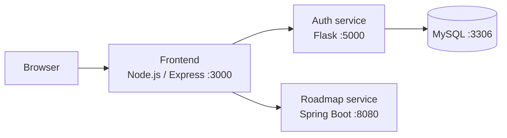

# IVOLVE × NTI Cloud DevOps Project

An end-to-end cloud delivery project for the IVOLVE microservices application. It brings together local containers, AWS infrastructure, configuration management, Jenkins-based continuous integration, Kubernetes, and GitHub Actions deployment.

> **Deployment choice:** this implementation uses GitHub Actions to deploy to Amazon EKS. The project brief names Argo CD; GitHub Actions is used here in its place, so the cluster is updated by workflow runs rather than by a continuously reconciling GitOps controller.

## Project goals

- Run the application and MySQL locally with Docker Compose.
- Provision a reproducible AWS environment with Terraform.
- Configure the Jenkins host with reusable Ansible roles.
- Build, scan, and publish service images through Jenkins.
- Keep Kubernetes manifests in Git and deploy their changes to EKS through GitHub Actions.
- Document the architecture, setup, operating steps, and evidence for each stage.

## Architecture

### Delivery workflow

```mermaid
flowchart LR
    Dev[Application change] --> Repo[GitHub source repository]
    Repo --> Jenkins[Jenkins on EC2<br/>dedicated agent and shared library]
    Jenkins --> Test[Test and build service images]
    Test --> Scan[Trivy image scan]
    Scan --> ECR[Amazon ECR]
    ECR --> Manifests[Update image tags in Kubernetes manifests]
    Manifests --> Git[Commit manifest change to GitHub]
    Git --> Actions[GitHub Actions deployment workflow]
    Actions --> OIDC[AWS IAM role through OIDC]
    OIDC --> EKS[Amazon EKS]
    EKS --> Rollout[Kubernetes rollout]
```



Jenkins is responsible for CI: it builds and scans images, publishes them to ECR, and records the desired image tag in Git. A change to the Kubernetes manifests starts the GitHub Actions workflow, which authenticates to AWS through OIDC and applies the manifests to EKS. This keeps deployment credentials out of the repository and makes each deployment traceable to a Git commit.

GitHub Actions performs deployment when a workflow runs. It does not provide Argo CD's continuous drift detection or automatic reconciliation between runs.

### Application services



| Service | Technology | Port | Responsibility |
|---|---|---:|---|
| Frontend | Node.js, Express, EJS | 3000 | Login, signup, and roadmap pages |
| Auth service | Python, Flask | 5000 | Signup and login API; persists user accounts |
| Roadmap service | Java 21, Spring Boot | 8080 | Serves roadmap data through an API |
| Database | MySQL 8 | 3306 | Stores authentication data for the Auth service |

The frontend calls the Auth and Roadmap services over the internal container network. Only the frontend port is published to the host for local development. The Auth service creates its `users` table when it connects to the database.

## Technology

| Area | Tools |
|---|---|
| Application | Node.js, Express, EJS, Python, Flask, Java 21, Spring Boot, MySQL |
| Containers | Docker, Docker Compose |
| Infrastructure | AWS, Terraform, Amazon EKS, Amazon ECR, S3 |
| Configuration | Ansible playbooks, roles, and dynamic inventory |
| CI | Jenkins, a dedicated agent, Groovy Shared Library, Trivy |
| Deployment | GitHub Actions, AWS IAM OIDC, Kubernetes |

## Repository layout

```text
.
├── app/
│   ├── auth-service/          # Flask authentication API
│   ├── frontend/              # Express and EJS web application
│   └── roadmap-service/       # Spring Boot roadmap API
├── docker/
│   ├── compose.yaml            # Local multi-service environment
│   └── .env.example            # Local configuration template
├── terraform/
│   ├── modules/                # Network, EKS, Jenkins, and ECR modules
│   └── environments/dev/       # Development environment composition
├── ansible/
│   ├── inventory/              # Static or dynamic inventory configuration
│   ├── playbooks/              # Host configuration entry points
│   └── roles/                  # Reusable Jenkins host setup
├── jenkins/                    # Pipeline and shared-library integration
├── kubernetes/
│   ├── base/                   # Shared Kubernetes resources
│   └── overlays/dev/           # Development environment settings
├── .github/workflows/          # EKS deployment workflow
└── docs/                       # Architecture, setup, and project evidence
```

## Run locally with Docker Compose

### Prerequisites

- Docker Engine or Docker Desktop with Docker Compose v2.
- Git, with this repository cloned locally.

### Start the application

In PowerShell, create the local environment file:

```powershell
Copy-Item docker/.env.example docker/.env
```

Edit `docker/.env` and replace the example passwords and session secret with local values. The file is ignored by Git; do not commit it.

Start the services from the repository root:

```powershell
docker compose --env-file docker/.env -f docker/compose.yaml up --build --detach
docker compose --env-file docker/.env -f docker/compose.yaml ps
```

Open [http://localhost:3000](http://localhost:3000), create a local account, and sign in to view the roadmap. Follow service logs with:

```powershell
docker compose --env-file docker/.env -f docker/compose.yaml logs --follow
```

Stop the containers while keeping the MySQL volume:

```powershell
docker compose --env-file docker/.env -f docker/compose.yaml down
```

### Local environment variables

| Variable | Used by | Purpose |
|---|---|---|
| `MYSQL_ROOT_PASSWORD` | MySQL | Local database administrator password |
| `DB_NAME` | MySQL, Auth service | Application database name; defaults to `ivolve` |
| `DB_USER` | MySQL, Auth service | Application database account |
| `DB_PASSWORD` | MySQL, Auth service | Application database password |
| `SESSION_SECRET` | Frontend | Signs the frontend session cookie |

The Compose file supplies service discovery addresses (`mysql`, `auth-service`, and `roadmap-service`) inside the Docker network. These are container names, not host addresses.

## Planned implementation stages

The project is being completed incrementally. The application source and local Compose definition are in place; the AWS and deployment stages remain under development.

1. **Local application:** run the services together and confirm the frontend, authentication, database, and roadmap flow.
2. **AWS infrastructure:** create the VPC and subnets, EKS cluster and private worker nodes, Jenkins EC2 host, ECR repositories, and S3 Terraform backend.
3. **Jenkins host configuration:** use Ansible roles to install Java, Jenkins, Docker, and Trivy; configure Jenkins and its agent connection.
4. **Kubernetes resources:** define the namespace, service Deployments and Services, MySQL StatefulSet and headless Service, storage, ConfigMaps, Secrets, and frontend Ingress.
5. **Continuous integration:** use Jenkins and shared-library steps to test, build, scan, and push service images, then update the corresponding manifest image tags in Git.
6. **Deployment:** use GitHub Actions with AWS OIDC to apply the updated Kubernetes configuration to EKS and verify the rollout.
7. **Documentation:** add setup instructions, architecture details, screenshots, and troubleshooting notes as each stage is completed.

## Security practices

- Keep `docker/.env`, private SSH keys, AWS credentials, Terraform state, and real variable files out of Git.
- Store deployment credentials in GitHub Actions secrets only when required; prefer short-lived AWS access through OIDC.
- Use Kubernetes Secrets for sensitive workload values and avoid placing real credentials in manifests.
- Limit the GitHub Actions IAM role to the EKS access and AWS actions required by the deployment workflow.

## Application source attribution

The application files in `app/` were provided by the course instructor and originate from [Ibrahim-Adel15/iVolveFinalProject](https://github.com/Ibrahim-Adel15/iVolveFinalProject), revision `adda14701d9119b142a767fe1f1d6486e4a8f25a`. The service table above follows the actual source files and Dockerfiles: Auth is Flask/Python, and Roadmap is Spring Boot/Java.

## Status

This is an active project. The local application and Compose setup are documented; Terraform, Ansible, Jenkins, Kubernetes, and GitHub Actions deployment files will be added and documented as they are implemented.
