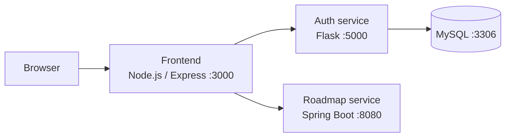

# IVOLVE × NTI Cloud DevOps Project

An end-to-end cloud delivery project for the IVOLVE microservices application. It brings together local containers, AWS infrastructure, configuration management, Jenkins-based continuous integration, Kubernetes, and GitHub Actions deployment.

> **Deployment choice:** this implementation uses GitHub Actions to deploy to Amazon EKS. The project brief names Argo CD; GitHub Actions is used here in its place, so the cluster is updated by workflow runs rather than by a continuously reconciling GitOps controller.

## Project goals

- Run the application and MySQL locally with Docker Compose.
- Provision a reproducible AWS environment with Terraform.
- Configure the Jenkins host with reusable Ansible roles.
- Build, scan, and publish service images through Jenkins.
- Keep Kubernetes manifests in Git and deploy their changes to EKS through GitHub Actions.
- Document the architecture, setup, operating steps, and evidence for each stage.

## Architecture

### Delivery workflow

```mermaid
flowchart LR
    Dev[Application change] --> Repo[GitHub source repository]
    Repo --> Jenkins[Jenkins on EC2<br/>dedicated agent and shared library]
    Jenkins --> Test[Test and build service images]
    Test --> Scan[Trivy image scan]
    Scan --> ECR[Amazon ECR]
    ECR --> Manifests[Update image tags in Kubernetes manifests]
    Manifests --> Git[Commit manifest change to GitHub]
    Git --> Actions[GitHub Actions deployment workflow]
    Actions --> IAMUser[Dedicated IAM deploy user<br/>repository secrets]
    IAMUser --> EKS[Amazon EKS]
    EKS --> Rollout[Kubernetes rollout]
```



Jenkins is responsible for CI: it builds and scans images and publishes them to ECR. GitHub Actions is the selected deployment mechanism for EKS. The organization SCP currently blocks creation of the GitHub OIDC provider, so the temporary fallback is a dedicated IAM deploy user whose access keys are stored as repository secrets. The user is limited to the application namespace; OIDC remains the preferred option when the organization policy permits it.

GitHub Actions performs deployment when a workflow runs. It does not provide Argo CD's continuous drift detection or automatic reconciliation between runs.

### Application services



| Service | Technology | Port | Responsibility |
|---|---|---:|---|
| Frontend | Node.js, Express, EJS | 3000 | Login, signup, and roadmap pages |
| Auth service | Python, Flask | 5000 | Signup and login API; persists user accounts |
| Roadmap service | Java 21, Spring Boot | 8080 | Serves roadmap data through an API |
| Database | MySQL 8 | 3306 | Stores authentication data for the Auth service |

The frontend calls the Auth and Roadmap services over the internal container network. Only the frontend port is published to the host for local development. The Auth service creates its `users` table when it connects to the database.

## Technology

| Area | Tools |
|---|---|
| Application | Node.js, Express, EJS, Python, Flask, Java 21, Spring Boot, MySQL |
| Containers | Docker, Docker Compose |
| Infrastructure | AWS, Terraform, Amazon EKS, Amazon ECR, S3 |
| Configuration | Ansible playbooks, roles, and dynamic inventory |
| CI | Jenkins, a dedicated agent, Groovy Shared Library, Trivy |
| Deployment | GitHub Actions, IAM deploy user, Kubernetes |

## Repository layout

```text
.
├── app/
│   ├── auth-service/          # Flask authentication API
│   ├── frontend/              # Express and EJS web application
│   └── roadmap-service/       # Spring Boot roadmap API
├── docker/
│   ├── compose.yaml            # Local multi-service environment
│   └── .env.example            # Local configuration template
├── terraform/
│   ├── modules/                # Network, EKS, Jenkins, and ECR modules
│   └── environments/dev/       # Development environment composition
├── ansible/
│   ├── inventory/              # Static or dynamic inventory configuration
│   ├── playbooks/              # Host configuration entry points
│   └── roles/                  # Reusable Jenkins host setup
├── jenkins/                    # Pipeline and shared-library integration
├── kubernetes/
│   ├── base/                   # Shared Kubernetes resources
│   └── overlays/dev/           # Development environment settings
├── .github/workflows/          # EKS deployment workflow
└── docs/                       # Architecture, setup, and project evidence
```

## Run locally with Docker Compose

### Prerequisites

- Docker Engine or Docker Desktop with Docker Compose v2.
- Git, with this repository cloned locally.

### Start the application

In PowerShell, create the local environment file:

```powershell
Copy-Item docker/.env.example docker/.env
```

Edit `docker/.env` and replace the example passwords and session secret with local values. The file is ignored by Git; do not commit it.

Start the services from the repository root:

Build the Spring Boot JAR in a temporary Maven container first. This avoids
running Maven as a Docker build step on machines where Docker Desktop's build
engine has an architecture or emulation issue:

```powershell
docker compose --profile build --env-file docker/.env -f docker/compose.yaml run --rm roadmap-builder
```

Then build and start the application containers:

```powershell
docker compose --env-file docker/.env -f docker/compose.yaml up --build --detach
docker compose --env-file docker/.env -f docker/compose.yaml ps
```

For local Compose, the roadmap service uses `app/roadmap-service/Dockerfile.local`
to package the JAR produced above. The regular multistage `Dockerfile` remains
available for CI builds.

Open [http://localhost:3000](http://localhost:3000), create a local account, and sign in to view the roadmap.

The screenshot below shows the roadmap page running locally after sign-in. The account email is hidden for privacy.


*Figure: The application roadmap served by the local Docker Compose stack.*

To view service logs, run:

```powershell
docker compose --env-file docker/.env -f docker/compose.yaml logs --follow
```

Stop the containers while keeping the MySQL volume:

```powershell
docker compose --env-file docker/.env -f docker/compose.yaml down
```

### Local environment variables

| Variable | Used by | Purpose |
|---|---|---|
| `MYSQL_ROOT_PASSWORD` | MySQL | Local database administrator password |
| `DB_NAME` | MySQL, Auth service | Application database name; defaults to `ivolve` |
| `DB_USER` | MySQL, Auth service | Application database account |
| `DB_PASSWORD` | MySQL, Auth service | Application database password |
| `SESSION_SECRET` | Frontend | Signs the frontend session cookie |

The Compose file supplies service discovery addresses (`mysql`, `auth-service`, and `roadmap-service`) inside the Docker network. These are container names, not host addresses.

## Requirements progress

This table tracks the NTI project brief. Argo CD was explicitly replaced with GitHub Actions by agreement; that substitution is reflected in the implementation and should be explained during the project review.

| Brief requirement | Status | Current implementation and remaining work |
|---|---|---|
| GitHub repository with README | Complete | The project repository and this README are in place. |
| Docker Compose for the application and database | Complete | `docker/compose.yaml` defines the local application stack and is committed. |
| Terraform Network, Server, EKS, and ECR modules | Partial | Modules provision the VPC, public/private subnets, Internet/NAT gateways, Jenkins EC2/security group, two EKS workers, and ECR repositories. The brief's dedicated Network ACL and S3 Terraform backend are not implemented yet; Terraform state currently uses the local backend. |
| Ansible playbook, roles, and dynamic inventory for Jenkins | Implemented; pending run | `ansible/` now contains the AWS EC2 dynamic inventory, a Jenkins host playbook, and roles for Java 21, Jenkins LTS, Docker, and Trivy. Run the playbook against the Terraform-managed Jenkins EC2 instance and verify the service before marking this complete. |
| Kubernetes application and database resources | Complete and deployed | The `ivolve` overlay applies the app Deployments/Services, MySQL StatefulSet and headless Service, gp3 StorageClass/PVC, ConfigMap/Secret, and frontend Ingress. The Ingress provisions an internet-facing ALB. |
| Jenkins CI pipeline for each service and Shared Library | Partial | Jenkinsfiles exist for the three services and use the shared library to build, scan with Trivy, and push images to ECR. The brief also asks for local image cleanup and automatic manifest update/push stages; those stages are not present yet. |
| Argo CD continuous deployment | Replaced by GitHub Actions | The `Deploy Dev to EKS` workflow successfully applies the Kubernetes overlay and checks rollouts. It runs on the self-hosted runner. The organization SCP blocks GitHub OIDC provider creation, so the current workflow uses a dedicated IAM deploy user stored as GitHub secrets. This is a manual workflow run, not Argo CD's continuous reconciliation. |
| Comprehensive documentation | In progress | This README documents the architecture and local setup. The requirement checklist is current; Ansible setup, Jenkins pipeline completion, Terraform backend/bootstrap, and final evidence still need documentation as they are implemented. |

## Security practices

- Keep `docker/.env`, private SSH keys, AWS credentials, Terraform state, and real variable files out of Git.
- Prefer short-lived AWS access through OIDC. The current organization policy blocks provider creation, so the fallback uses a dedicated deploy-only IAM user in GitHub Actions secrets.
- Use Kubernetes Secrets for sensitive workload values and avoid placing real credentials in manifests.
- Limit the GitHub Actions IAM user to `eks:DescribeCluster` and namespace-scoped Kubernetes deployment access.

## Current deployment status

- The EKS cluster has two Ready worker nodes in private subnets, and the application workloads and MySQL PVC were observed healthy.
- The frontend, authentication, and roadmap pages were opened successfully through the ALB address. The roadmap content is static application data; it is not a user-editable list stored in MySQL.
- The AWS Load Balancer Controller deployment is healthy, and the `frontend` Ingress has an ALB address.
- The GitHub Actions deployment workflow completed successfully and reapplied the development manifests.
- Docker Desktop local runtime has experienced disk-space/daemon startup problems. The AWS deployment is separate from that local Docker issue.

## Remaining work

1. Run the Ansible inventory and playbook against the Jenkins EC2 instance, then connect the project's Jenkins agent and verify the controller.
2. Complete the missing Jenkins CI stages for image cleanup and manifest update/commit/push, then verify all three service pipelines.
3. Add the Network ACL and bootstrap an S3 Terraform backend, then document the safe state migration.
4. Finish setup/troubleshooting documentation and capture final project evidence.
