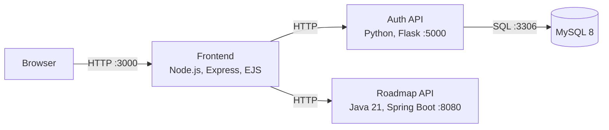

# IVOLVE Application

The application provides a signup and login page, then displays a DevOps learning roadmap. It is split into a web frontend and two backend services. The Auth service stores user accounts in MySQL; the Roadmap service returns roadmap content to the frontend.

## Service architecture



| Service | Technology | Port | Responsibility |
|---|---|---:|---|
| Frontend | Node.js, Express, EJS | 3000 | Serves the pages, calls backend APIs, and manages the user session |
| Auth service | Python, Flask, bcrypt | 5000 | Validates signup and login requests and reads/writes user records |
| Roadmap service | Java 21, Spring Boot | 8080 | Returns the roadmap as JSON |
| MySQL | MySQL 8 | 3306 | Stores usernames and password hashes |

In the local Compose setup, only the frontend port is published to the host. Backend services and MySQL communicate over the private Compose network.

## User request flow

### Signup

1. The browser submits a username and password to `POST /signup` on the frontend.
2. The frontend sends the credentials to `POST /api/auth/signup` on the Auth service.
3. The Auth service validates the input, hashes the password with bcrypt, and stores the account in MySQL.
4. The browser is redirected to the login page.

Usernames must contain at least three characters and passwords at least eight characters. Duplicate usernames return a conflict response.

### Login and roadmap

1. The browser submits credentials to `POST /login` on the frontend.
2. The frontend calls `POST /api/auth/login` on the Auth service.
3. The Auth service checks the password against the stored bcrypt hash.
4. On success, the frontend stores the user in its session and redirects to `/roadmap`.
5. The frontend requests roadmap data from `GET /api/roadmap` and renders the response.

## HTTP routes

### Frontend

| Method | Route | Purpose |
|---|---|---|
| `GET` | `/` | Render login page or redirect a signed-in user to the roadmap |
| `GET` | `/signup` | Render signup page |
| `POST` | `/signup` | Submit signup form to the Auth service |
| `POST` | `/login` | Authenticate and start a frontend session |
| `GET` | `/roadmap` | Render roadmap for a signed-in user |
| `POST` | `/logout` | End the frontend session |

### Backend APIs

| Service | Method | Route | Purpose |
|---|---|---|---|
| Auth | `GET` | `/health` | Report service and database connectivity |
| Auth | `POST` | `/api/auth/signup` | Create a user account |
| Auth | `POST` | `/api/auth/login` | Validate credentials and return the user |
| Roadmap | `GET` | `/api/roadmap` | Return roadmap topics as JSON |

## Configuration

The frontend and Auth service are configured through environment variables. The Docker Compose file supplies the service addresses for local containers.

| Variable | Service | Description |
|---|---|---|
| `AUTH_SERVICE_URL` | Frontend | Base URL for the Auth API |
| `ROADMAP_SERVICE_URL` | Frontend | Base URL for the Roadmap API |
| `SESSION_SECRET` | Frontend | Secret used to sign the session cookie |
| `DB_HOST` | Auth | MySQL hostname, `mysql` in Compose |
| `DB_PORT` | Auth | MySQL port, `3306` in Compose |
| `DB_NAME` | Auth | Database name, `ivolve` in Compose |
| `DB_USER` | Auth | MySQL application account |
| `DB_PASSWORD` | Auth | Password for the MySQL application account |

Set local values in `docker/.env`, created from `docker/.env.example`. Do not commit the local `.env` file or real credentials.

## Database

The Auth service creates the `users` table when it connects to MySQL:

| Column | Type | Use |
|---|---|---|
| `id` | Auto-increment integer | Primary key |
| `username` | `VARCHAR(100)` | Unique account name |
| `password_hash` | `VARCHAR(255)` | bcrypt password hash |
| `created_at` | Timestamp | Account creation time |

The Roadmap service currently serves its roadmap data from the application; it does not connect to MySQL.

## Code layout

```text
app/
├── auth-service/
│   ├── app.py
│   ├── requirements.txt
│   └── Dockerfile
├── frontend/
│   ├── server.js
│   ├── package.json
│   ├── views/
│   └── public/
└── roadmap-service/
    ├── pom.xml
    ├── Dockerfile
    └── src/main/
```

## Run the application

Follow the root [README](../README.md#run-locally-with-docker-compose) for environment setup and Docker Compose commands. The Compose definition builds each service from its directory under `app/`.

The frontend uses an HTTP-only session cookie. Its default session store is suitable for the local learning environment; a multi-replica deployment should use a shared session store.
