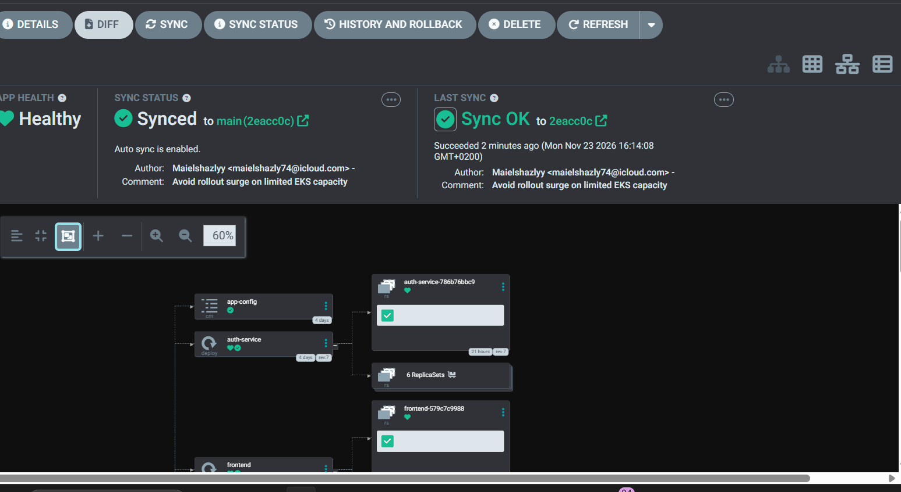
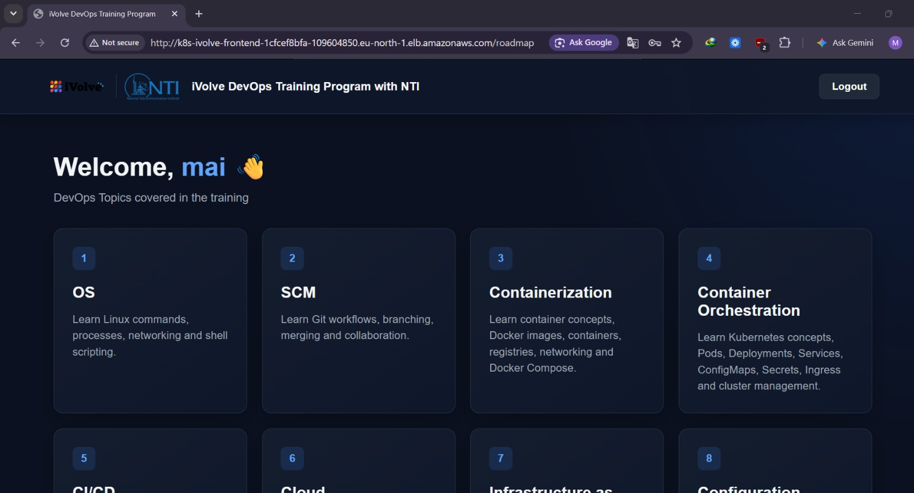

# Architecture, Evidence, and Demo

This guide presents the branded architecture image, project walkthrough videos, and evidence captures. The current delivery model uses GitHub Actions for CI and Argo CD for CD; Jenkins and its Jenkins-specific Ansible host configuration were removed from the project.

## Architecture diagram

- Editable vector diagram: [`images/ivolve-platform-architecture.svg`](images/ivolve-platform-architecture.svg).
- PNG used by the repository README and presentations: [`images/ivolve-platform-architecture.png`](images/ivolve-platform-architecture.png).
- Pillow source: [`images/render_architecture.py`](images/render_architecture.py). From the repository root, regenerate the PNG with `python docs/images/render_architecture.py`.

The diagram shows GitHub Actions building and scanning images, publishing to ECR, committing new immutable image references, and Argo CD syncing Git manifests to EKS. Terraform provisions the AWS network, EKS, ECR, IAM, and S3 state. EKS runs the frontend, APIs, and persistent MySQL database; the AWS Load Balancer Controller exposes the frontend through an ALB.

## Demo videos

The silent video set is designed for GitHub/portfolio and LinkedIn. It uses the iVolve and NTI branding plus technology and AWS logos, with animated process graphics. Captions are available as separate sidecar files; clean versions have no transcript panels or captions.

| Use | Video | Cover | Captions |
|---|---|---|---|
| GitHub / portfolio | [`demo/ivolve-devops-explainer.mp4`](demo/ivolve-devops-explainer.mp4) | [`demo/ivolve-devops-explainer-cover.png`](demo/ivolve-devops-explainer-cover.png) | [`demo/ivolve-devops-explainer.srt`](demo/ivolve-devops-explainer.srt) |
| LinkedIn | [`demo/ivolve-devops-linkedin.mp4`](demo/ivolve-devops-linkedin.mp4) | [`demo/ivolve-devops-linkedin-cover.png`](demo/ivolve-devops-linkedin-cover.png) | [`demo/ivolve-devops-linkedin.srt`](demo/ivolve-devops-linkedin.srt) |
| GitHub / portfolio, clean | [`demo/ivolve-devops-explainer-no-captions.mp4`](demo/ivolve-devops-explainer-no-captions.mp4) | [`demo/ivolve-devops-explainer-no-captions-cover.png`](demo/ivolve-devops-explainer-no-captions-cover.png) | None |
| LinkedIn, clean | [`demo/ivolve-devops-linkedin-no-captions.mp4`](demo/ivolve-devops-linkedin-no-captions.mp4) | [`demo/ivolve-devops-linkedin-no-captions-cover.png`](demo/ivolve-devops-linkedin-no-captions-cover.png) | None |

The videos explain the application and Docker Compose, Terraform, GitHub Actions CI, Trivy, ECR, Argo CD, EKS workloads, persistent MySQL storage, and the public ALB.

## Evidence screenshots

These captures document the local stack, the CI/CD handoff, and the running EKS application. Older Jenkins and direct GitHub Actions-to-EKS deployment screenshots are intentionally omitted because that architecture has been replaced by GitHub Actions CI plus Argo CD CD.

Docker Compose started the local services

GitHub Actions built, scanned, and published service images

Argo CD synced the Git revision and reported the application healthy

EKS nodes, workloads, persistent storage, and Ingress

Application served through the AWS ALB

Logo license information for the project visuals is in [`demo/assets/SIMPLE-ICONS-LICENSE.md`](demo/assets/SIMPLE-ICONS-LICENSE.md).
