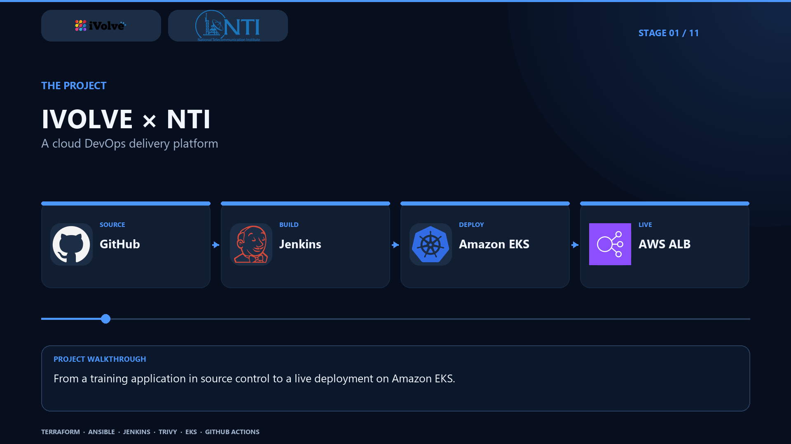
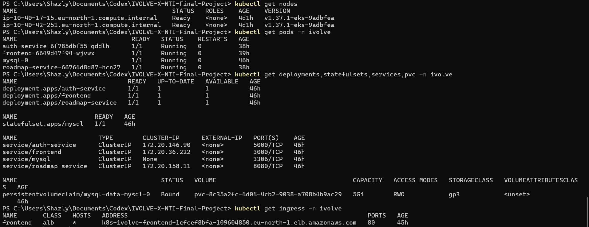
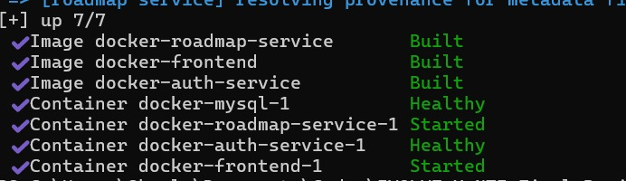
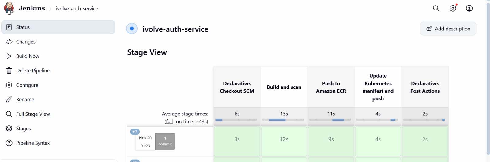
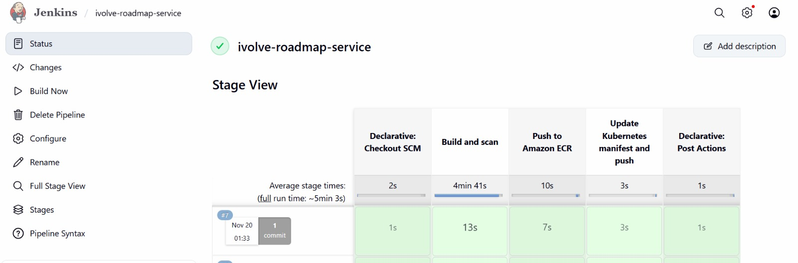
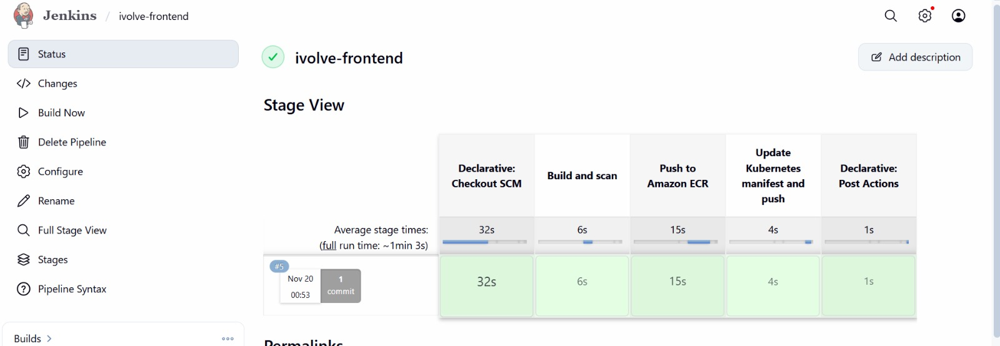
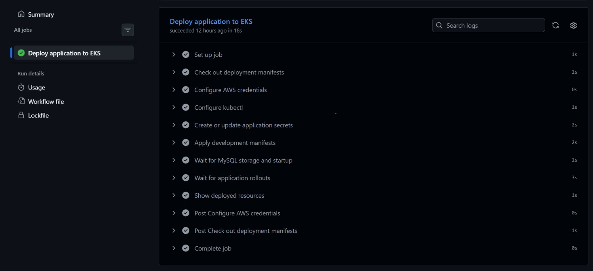

# Project Architecture and Demo Videos

This is the single README for everything under `docs/`: the full system architecture diagram, four stage-by-stage demo videos, video covers and caption files, and the scripts and logo assets used to generate them.

## Architecture diagram


- Editable vector: [`images/ivolve-platform-architecture.svg`](images/ivolve-platform-architecture.svg).
- Raster image for slides and social media: [`images/ivolve-platform-architecture.png`](images/ivolve-platform-architecture.png).
- Diagram source and rendering script: [`images/render_architecture.py`](images/render_architecture.py). Run `python docs/images/render_architecture.py` from the repository root to regenerate the PNG (requires Pillow).
- The diagram uses the project and service marks plus AWS and technology logos; the source assets are kept in [`demo/assets/logos/`](demo/assets/logos/) and the frontend brand marks in `app/frontend/public/images/`.

## Demo videos

The videos are silent, use the actual iVolve and NTI marks plus technology/AWS service logos, and explain the project through original process graphics. They show the implementation path from the application and Docker through Terraform, Ansible, Jenkins, ECR, GitHub Actions, EKS, and the ALB. No AWS, Jenkins, GitHub, or browser screenshots are used.

| Intended use | Video | Cover | Captions |
|---|---|---|---|
| GitHub / portfolio, with explanations | [`demo/ivolve-devops-explainer.mp4`](demo/ivolve-devops-explainer.mp4) — 16:9, 67 sec | [`demo/ivolve-devops-explainer-cover.png`](demo/ivolve-devops-explainer-cover.png) | [`demo/ivolve-devops-explainer.srt`](demo/ivolve-devops-explainer.srt) |
| LinkedIn, with explanations | [`demo/ivolve-devops-linkedin.mp4`](demo/ivolve-devops-linkedin.mp4) — 9:16, 55 sec | [`demo/ivolve-devops-linkedin-cover.png`](demo/ivolve-devops-linkedin-cover.png) | [`demo/ivolve-devops-linkedin.srt`](demo/ivolve-devops-linkedin.srt) |
| GitHub / portfolio, clean version | [`demo/ivolve-devops-explainer-no-captions.mp4`](demo/ivolve-devops-explainer-no-captions.mp4) — 16:9, 67 sec | [`demo/ivolve-devops-explainer-no-captions-cover.png`](demo/ivolve-devops-explainer-no-captions-cover.png) | None |
| LinkedIn, clean version | [`demo/ivolve-devops-linkedin-no-captions.mp4`](demo/ivolve-devops-linkedin-no-captions.mp4) — 9:16, 55 sec | [`demo/ivolve-devops-linkedin-no-captions-cover.png`](demo/ivolve-devops-linkedin-no-captions-cover.png) | None |

The first two videos include English explanation panels and matching `.srt` files. The clean versions omit those explanation panels and have no subtitle files, while keeping stage headings, tool names, logos, and process graphics.



## Deployment evidence

These user-provided captures show the local stack, EKS workload health, the application through its AWS ALB, all three green Jenkins pipeline Stage Views, and a successful GitHub Actions deployment. Select a row to expand its screenshot.

<details>
<summary>EKS nodes, workloads, persistent storage, and Ingress are healthy</summary>



</details>

<details>
<summary>Docker Compose started the local services</summary>



</details>

<details>
<summary>Application served through the AWS ALB</summary>


</details>

<details>
<summary>Jenkins pipeline: Auth service</summary>



</details>

<details>
<summary>Jenkins pipeline: Roadmap service</summary>



</details>

<details>
<summary>Jenkins pipeline: Frontend</summary>



</details>

<details>
<summary>GitHub Actions deployment to EKS</summary>



</details>

## Stages in the videos

1. Project overview and delivery path.
2. Frontend, Auth API, Roadmap API, and MySQL.
3. Local development with Docker Compose.
4. AWS infrastructure created with Terraform.
5. Jenkins host setup with Ansible.
6. Three Jenkins service pipelines.
7. Trivy scans, ECR publishing, and manifest image-tag updates.
8. GitHub Actions deployment to EKS.
9. Kubernetes workloads and gp3-backed MySQL storage.
10. AWS ALB routing browser traffic to the frontend and APIs.
11. End-to-end path from a code change to the live application.

## Regenerate the assets and videos

From the repository root on Windows, install Python Pillow and use Windows PowerShell with WPF plus FFmpeg built with `libx264`:

```powershell
powershell.exe -NoProfile -ExecutionPolicy Bypass -STA -File docs/demo/render_simple_icons.ps1
python docs/images/render_architecture.py
python docs/demo/generate_explainer.py --ffmpeg "C:\tools\ffmpeg\bin\ffmpeg.exe"
python docs/demo/generate_explainer.py --ffmpeg "C:\tools\ffmpeg\bin\ffmpeg.exe" --no-captions
```

The first command renders the SVG technology logos for the videos. The second regenerates the architecture PNG. The third makes the explanation-panel videos, covers, and `.srt` files; the last makes the clean videos and covers. The generated MP4s use H.264 and contain no audio. These scripts need no AWS access, project secrets, or screenshots.

Logo source assets are under `demo/assets/logos/`. The iVolve/NTI marks come from the app's existing frontend assets, AWS service marks are from the AWS architecture asset package, and technology logos use Simple Icons. See [`demo/assets/SIMPLE-ICONS-LICENSE.md`](demo/assets/SIMPLE-ICONS-LICENSE.md) for license information.
