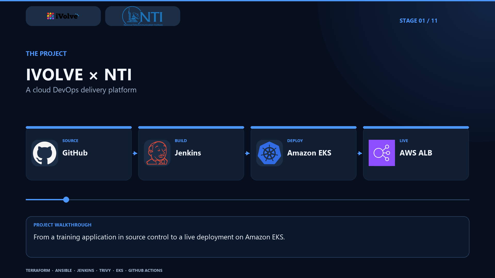

# IVOLVE DevOps explainer video

Two screenshot-free, logo-led explainer videos are ready. They use the actual iVolve and NTI application marks, recognizable logos for the technologies used, AWS service icons, original process graphics, and short cross-fade transitions. They explain the delivery path from local development to the live application. They contain no captured AWS, Jenkins, GitHub, or browser screens and have no audio track.

## Video files

| Audience | Video | Cover | Captions |
|---|---|---|---|
| GitHub / portfolio | [`ivolve-devops-explainer.mp4`](ivolve-devops-explainer.mp4) — 67 seconds, 1920×1080, H.264 | [`ivolve-devops-explainer-cover.png`](ivolve-devops-explainer-cover.png) | [`ivolve-devops-explainer.srt`](ivolve-devops-explainer.srt) |
| LinkedIn | [`ivolve-devops-linkedin.mp4`](ivolve-devops-linkedin.mp4) — 55 seconds, 1080×1920, H.264 | [`ivolve-devops-linkedin-cover.png`](ivolve-devops-linkedin-cover.png) | [`ivolve-devops-linkedin.srt`](ivolve-devops-linkedin.srt) |
| GitHub / portfolio, clean | [`ivolve-devops-explainer-no-captions.mp4`](ivolve-devops-explainer-no-captions.mp4) — 67 seconds, 1920×1080, H.264 | [`ivolve-devops-explainer-no-captions-cover.png`](ivolve-devops-explainer-no-captions-cover.png) | None |
| LinkedIn, clean | [`ivolve-devops-linkedin-no-captions.mp4`](ivolve-devops-linkedin-no-captions.mp4) — 55 seconds, 1080×1920, H.264 | [`ivolve-devops-linkedin-no-captions-cover.png`](ivolve-devops-linkedin-no-captions-cover.png) | None |



The first two versions have English explanations burned into the video and separate SRT files for closed captions. The clean versions remove the explanation panels and have no SRT subtitle files; they keep the project stages, tool names, logos, and process graphics. All four versions are silent. Logo sources and rendering notes are documented in [`assets/README.md`](assets/README.md).

## Stages covered

1. Project overview and end-to-end flow.
2. Frontend, Auth API, Roadmap API, and MySQL.
3. Local development with Docker Compose.
4. AWS networking and resources provisioned by Terraform.
5. Jenkins host configuration using Ansible.
6. The three Jenkins service pipelines.
7. Trivy scanning, ECR publishing, and Kubernetes image-tag updates.
8. GitHub Actions deployment workflow.
9. EKS workloads and gp3-backed MySQL storage.
10. AWS ALB routing to the application.
11. How the stages form one delivery path.

## Rebuild the videos

The graphics and exports can be regenerated from the repository root. Python, Pillow, Windows PowerShell with WPF, and an FFmpeg build with `libx264` are required. Supply the path to your FFmpeg executable:

```powershell
powershell.exe -NoProfile -ExecutionPolicy Bypass -STA -File docs/demo/render_simple_icons.ps1
python docs/demo/generate_explainer.py --ffmpeg "C:\tools\ffmpeg\bin\ffmpeg.exe"
python docs/demo/generate_explainer.py --ffmpeg "C:\tools\ffmpeg\bin\ffmpeg.exe" --no-captions
```

The first command recreates the original captioned MP4s, covers, and SRT files. The second creates the clean MP4s and matching covers without SRT files. The icon rendering script recreates the technology logo PNGs. The scripts do not need project credentials or application screenshots.

## Publishing

- Link the landscape video from the GitHub README or attach it to a GitHub Release.
- Upload the vertical video to LinkedIn; its larger text and 9:16 layout are intended for mobile viewing.
- The architecture source and presentation image are in [`../images/README.md`](../images/README.md).
- Optional real screenshots for a separate README evidence gallery are listed in [`../SCREENSHOT_CHECKLIST.md`](../SCREENSHOT_CHECKLIST.md); they are not required by either video.
